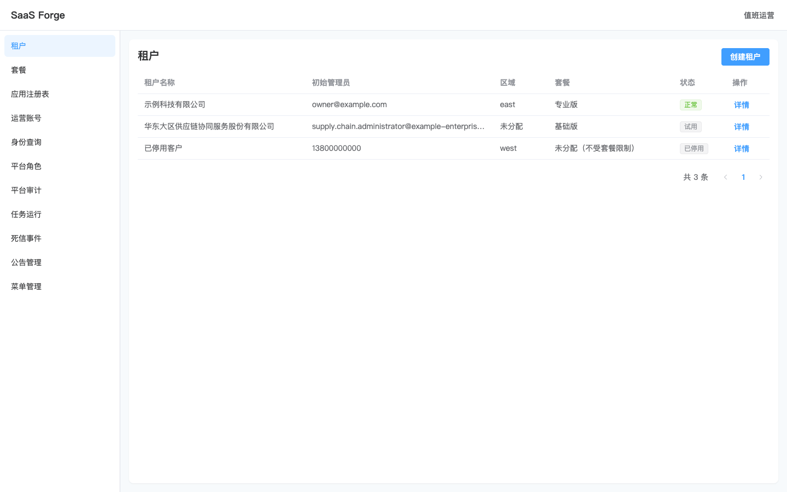
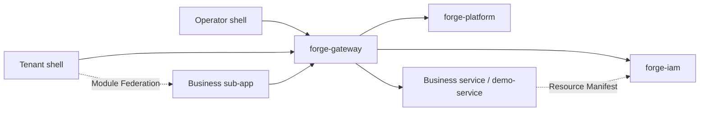

# SaaS Forge

**A multi-tenant SaaS platform and SDK for business applications**

[简体中文](README.md) | English

SaaS Forge includes operator and tenant consoles, identity and authorization services, modular Spring Boot starters, and Vue sub-app tooling. Teams can develop backend services and frontend sub-apps in separate repositories while reusing tenant isolation, authentication, authorization, navigation, auditing, and messaging.

[Run locally](#run-locally) · [Build integrations](#develop-business-services-and-sub-apps) · [SDK](#forge-sdk) · [Validation and CI](#validation-and-ci) · [Documentation](#documentation)

## Implemented capabilities

| Area                           | Capabilities                                                                                                                                                                                                                              |
| ------------------------------ | ----------------------------------------------------------------------------------------------------------------------------------------------------------------------------------------------------------------------------------------- |
| Identity and account security  | Global identities and tenant memberships, tenant switching, separate operator and tenant realms, OAuth2 authorization code flow with PKCE, refresh token rotation, immediate revocation, TOTP MFA, login lockout, and password management |
| Tenant operations              | Tenant provisioning, initialization, suspension, and deletion workflows; plans and feature packs; operator accounts, platform roles, and an app registry                                                                                  |
| Organization and authorization | Member invitations, departments, positions, extended attributes, RBAC permissions, ABAC data policies, tenant IP allowlists, and navigation filtered by permissions and plans                                                             |
| Tenant isolation               | A shared PostgreSQL schema model, MyBatis-Plus tenant predicates and PostgreSQL RLS, with tenant context carried through caches, messages, and tasks                                                                                      |
| Everyday workflows             | In-app notifications, business todos, announcements, audit logs, dictionaries, parameters, and navigation layout management                                                                                                               |
| Business and operations        | S3 object storage, asynchronous Excel imports and exports, business numbering, tenant scheduling and run history, transactional outbox, idempotent consumption, and dead-event inspection and replay                                      |
| Extensions                     | A backend Maven archetype, a frontend sub-app generator, Module Federation loading, shared SDK/UI packages, and integration standards                                                                                                     |

The included `demo-service` and `demo-sub-app` demonstrate orders, attachments, imports and exports, notifications, and todos working together.

<details>
<summary>Preview: tenant management in the operator console</summary>



This screenshot is a visual regression baseline using test fixtures. The current UI is primarily in Simplified Chinese.

</details>

## Architecture and layout



The gateway provides routing and authentication at the entry point. IAM manages identities, permissions, and tenant access context; Platform manages tenant operations and service administration. Business services integrate through Forge SDK and report permission, menu, and data-resource declarations to IAM. The tenant shell loads sub-apps according to permissions, plans, and the app registry.

```text
backend/                       Maven modules
  forge-dependencies/          BOM and shared build configuration
  forge-architecture/          Reusable ArchUnit rules
  forge-sdk/                   17 SDK modules grouped by capability
  forge-gateway/               API gateway and aggregated OpenAPI
  forge-iam/                   Identity, authorization, tenant capabilities
  forge-platform/              Platform operations and administration
  forge-service-archetype/     Standalone business-service generator
  examples/demo-service/       Example business service
frontend/                      pnpm workspace
  apps/platform-console/      Operator shell
  apps/tenant-app/             Tenant shell
  apps/demo-sub-app/           Example sub-app
  packages/sdk/               @crane199709/sdk
  packages/ui/                @crane199709/ui
  packages/sub-app-kit/       @crane199709/sub-app-kit
deploy/                        Local dependencies, image docs, isolated checks
scripts/                       CI selection, releases, image builds
docs/                          Integration guides, standards, ADRs
```

| Layer          | Stack                                                                                                    |
| -------------- | -------------------------------------------------------------------------------------------------------- |
| Backend        | Java 17, Spring Boot 4.0.9, Spring Cloud 2025.1.4, Spring Cloud Alibaba 2025.1.0.0, MyBatis-Plus, Flyway |
| Frontend       | Vue 3, TypeScript 5.9, Vite, Element Plus, Pinia, Module Federation                                      |
| Infrastructure | PostgreSQL 17, Redis 8, Nacos 3, RocketMQ 5, S3-compatible storage                                       |
| Validation     | JUnit, Testcontainers, ArchUnit, Vitest, Playwright, Spotless, Prettier, Stylelint                       |

The current development version is `0.2.0-SNAPSHOT`. The backend revision is defined in `backend/.mvn/maven.config`. External integrations must use a release matching the target platform; see the [release guide](scripts/release/README.md).

## Run locally

Run the following commands from the repository root unless stated otherwise. These steps set up an isolated local demo environment.

### Prerequisites

- JDK 17; use the included `backend/mvnw` wrapper.
- Node.js 24+ and pnpm 12.4.2.
- Docker with Compose v2.
- Bash and OpenSSL; E2E and release scripts also require Python 3.

### 1. Start dependencies

```bash
docker compose -f deploy/docker-compose.yml up -d
docker compose -f deploy/docker-compose.yml ps -a
```

Compose starts the database, cache, service registry and configuration center, message queue, and object storage. The one-shot `nacos-init`, `rocketmq-init`, and `s3-init` services publish configuration, create topics, and create the bucket, respectively. Each should finish with exit code 0.

| Dependency            | Default host ports        | Local setup                                                                                        |
| --------------------- | ------------------------- | -------------------------------------------------------------------------------------------------- |
| PostgreSQL            | 5432                      | Database `forge`; separate schemas, migration users, and runtime users for iam, platform, and demo |
| Redis                 | 6379                      | Sessions, permission versions, tenant state, and related data                                      |
| Nacos                 | 8848, 9848; console 18080 | [Console](http://localhost:18080), local credentials `nacos/nacos`                                 |
| RocketMQ Proxy        | 8081                      | gRPC endpoint for the native Java client                                                           |
| S3-compatible storage | 9000                      | Local silo instance, bucket `forge`                                                                |

Data is stored under the Git-ignored `deploy/data/` directory. PostgreSQL initialization runs only on an empty data directory. For a new service on an existing database, follow the [platform onboarding checklist](docs/service-onboarding-checklist.md) to provision its schema and users. Port overrides are listed in the [Compose configuration](deploy/docker-compose.yml); update application connection settings when changing ports.

### 2. Build and prepare local tokens

```bash
(cd backend && ./mvnw install -DskipTests)
pnpm --dir frontend install --frozen-lockfile
```

Generate a separate operations token for each service and the Lowcode manifest token referenced by the local configuration. This command adds missing variables and preserves existing values:

```bash
(
  umask 077
  touch .env.ops.local
  for name in FORGE_IAM_OPS_TOKEN FORGE_PLATFORM_OPS_TOKEN FORGE_DEMO_OPS_TOKEN FORGE_LOWCODE_MANIFEST_TOKEN; do
    if ! grep -q "^${name}=" .env.ops.local; then
      printf '%s=%s\n' "$name" "$(openssl rand -hex 32)" >> .env.ops.local
    fi
  done
)
```

`.env.ops.local` is Git-ignored. IAM, Platform, and Demo use separate operations tokens. Platform needs all three to call internal service operations endpoints. IAM also references `FORGE_LOWCODE_MANIFEST_TOKEN`; this repository contains no Lowcode service module. When integrating an external Lowcode service, configure the same manifest token on both sides.

### 3. Start backend services

In **each backend terminal**, load the variables and read the current build version from the repository root:

```bash
set -a
source .env.ops.local
set +a
FORGE_VERSION=$(sed -n 's/^-Drevision=//p' backend/.mvn/maven.config)
```

Then run one of the following commands in each of four terminals:

```bash
java -jar "backend/forge-iam/target/forge-iam-${FORGE_VERSION}.jar" --spring.profiles.active=demo
```

```bash
java -jar "backend/forge-platform/target/forge-platform-${FORGE_VERSION}.jar"
```

```bash
java -jar "backend/examples/demo-service/target/demo-service-${FORGE_VERSION}.jar"
```

```bash
java -jar "backend/forge-gateway/target/forge-gateway-${FORGE_VERSION}.jar"
```

> [!IMPORTANT]
> The `demo` profile seeds accounts with known passwords and is intended only for an isolated local environment. Default startup does not load these accounts. Once demo migrations have run on a database, keep this profile enabled on subsequent starts to avoid Flyway validation failures.

| Service        | Default port | Gateway prefix |
| -------------- | ------------ | -------------- |
| forge-gateway  | 8080         | —              |
| forge-iam      | 8101         | `/iam`         |
| forge-platform | 8102         | `/platform`    |
| demo-service   | 8201         | `/demo`        |

Services run Flyway using migration credentials and access application data with runtime credentials. They import `forge-common.yaml` from Nacos; the gateway also imports `forge-gateway.yaml`. Connection pools and tenant session data sources do not participate in hot refresh. Restart services after changing database connection settings.

For IDEA run configurations, set the same environment variables and use the repository root as the working directory. Enable the `demo` profile for IAM. IDEA does not automatically load `.env.ops.local`; do not commit run configurations containing real tokens.

### 4. Start the frontend and sign in

Run these commands in three separate terminals:

```bash
pnpm --dir frontend dev:platform
```

```bash
pnpm --dir frontend dev:tenant
```

```bash
pnpm --dir frontend start:demo
```

| Entry               | Address                                                | Demo account                                   | Demo password            |
| ------------------- | ------------------------------------------------------ | ---------------------------------------------- | ------------------------ |
| Operator console    | [localhost:5173](http://localhost:5173)                | `operator`                                     | `Operator-password-123!` |
| Tenant console      | [localhost:5174](http://localhost:5174)                | `demo`                                         | `Demo-password-123!`     |
| Example sub-app     | [remoteEntry.js](http://127.0.0.1:5175/remoteEntry.js) | Loaded by the tenant shell; shares its session | —                        |
| Aggregated API docs | [Swagger UI](http://localhost:8080/swagger-ui.html)    | Select a service                               | —                        |

`start:demo` builds the sub-app and serves a preview; run it again after changing its source. IAM demo data registers the example entry for the `local` environment. Sign in to the tenant console to open the orders page. See [tenant login](docs/tenant-login.md) and [operator login](docs/platform-login.md) for authentication details.

Common checks:

- `forge.ops.token must be set`: check the current terminal or IDE environment. After rotating a token, update Platform and the corresponding service, then restart them.
- Missing gateway routes: confirm that `nacos-init` succeeded. After editing repository Nacos configuration, republish it with `docker compose -f deploy/docker-compose.yml up nacos-init`.
- A sub-app is missing or fails to load: check `start:demo`, the entry URL, IAM's `FORGE_ENVIRONMENT` setting (default `local`), member permissions, and plan scope.

## Develop business services and sub-apps

Backend and frontend projects can be developed outside this repository:

1. Generate a business service with `io.saasforge:forge-service-archetype`, inherit `forge-dependencies`, and select the SDK modules it needs. See the [business service guide](docs/business-service-guide.md) for commands and required configuration.
2. Generate a sub-app with `forge-create-sub-app` from `@crane199709/sub-app-kit`, reusing `@crane199709/sdk` and `@crane199709/ui`. See the [sub-app guide](docs/sub-app.md) for standalone generation, the development host, and publishing steps.
3. On the platform side, prepare database users, manifest tokens, topics, gateway routes, and authentication prefixes. Register the app and configure plans and role permissions. Verify each step using the [onboarding checklist](docs/service-onboarding-checklist.md).

To create a sub-app inside this repository:

```bash
cd frontend
pnpm create:sub-app billing 5180
pnpm install
pnpm --filter @forge/billing-sub-app dev
```

The standalone development host supports HMR. Verify actual federated loading using built assets and the tenant shell. Add new business prefixes to the shell's development proxy: a sub-app's `apiPrefixes` setting does not update that proxy. Use a matching release for the shell, sub-app, and shared packages; do not upgrade shared dependencies independently.

## Forge SDK

Backend artifacts use the `io.saasforge` group, with versions managed by `forge-dependencies`.

| Modules (without the `forge-sdk-` prefix) | Responsibility                                                                                    |
| ----------------------------------------- | ------------------------------------------------------------------------------------------------- |
| `core`, `web`, `openapi`                  | Tenant context, response and error envelopes, pagination, business time zone, OpenAPI             |
| `security`, `tenant`, `abac`              | JWT validation, permissions, tenant SQL isolation and RLS sessions, data policies                 |
| `manifest`, `provisioning`                | Permission and menu reporting, tenant initialization and cleanup extension points                 |
| `mq`, `notification`                      | RocketMQ, transactional outbox, idempotent consumption, dead events, notification and todo events |
| `audit`, `ops`, `scheduling`              | Audit events, operations endpoints with separate tokens, declarative scheduling and run history   |
| `storage`, `io`                           | Purpose-constrained S3 storage, asynchronous Excel validation and import confirmation, exports    |
| `numbering`, `referencedata`              | Business numbering and effective tenant dictionaries and parameters                               |

The three published frontend packages provide session and API clients, shared UI components, and generation, build, and isolation-check tooling. See the [backend standards](docs/standards/business-service.md) and [frontend standards](docs/standards/sub-app.md) for integration constraints.

## Validation and CI

| Quality workflow | Coverage                                                                                                                          |
| ---------------- | --------------------------------------------------------------------------------------------------------------------------------- |
| Backend quality  | Maven tests, Testcontainers integration tests, ArchUnit, Spotless, and generated archetype project verification                   |
| Frontend quality | Type checking, unit tests, Prettier, Stylelint, builds, and mocked browser regressions                                            |
| Main flow E2E    | Real login and sub-app loading, two-tenant isolation, functional and data permissions, immediate revocation, and realm separation |
| Template smoke   | Temporary Maven/npm publication, standalone project generation, build, and runtime integration                                    |

PRs and pushes to `main` select heavy checks based on changed paths. Manual runs and release tags run the full checks. Ordinary Markdown changes skip heavy steps; see the [CI guide](docs/ci.md).

Common local commands:

```bash
# Full backend verification, including independent generated-project consumption
(cd backend && ./mvnw --batch-mode install -Parchetype-it)

# Frontend types, unit tests, formatting, styles, and builds
(cd frontend && pnpm typecheck && pnpm test && pnpm format:check && pnpm lint:style && pnpm build)

# Mocked browser regressions; build:spike prepares diagnostics and sub-app v2
(cd frontend && pnpm build:spike && pnpm exec playwright install --with-deps chromium && pnpm test:e2e)

# Real main-flow and template checks in isolated containers; run separately
deploy/e2e/run.sh
deploy/template-smoke/run.sh

# Notification and todo E2E; currently run manually
pnpm --dir frontend test:e2e:notification
```

When iterating on a backend module, first run `./mvnw -o -pl <module> -am install -DskipTests` from `backend`, then run `./mvnw -o -pl <module> test -Dtest=<TestClass>` for focused verification. Offline commands require cached dependencies. Apply formatting with `(cd backend && ./mvnw spotless:apply)` and `pnpm --dir frontend format`. Run visual regressions with `pnpm --dir frontend test:visual`.

Main-flow E2E uses separate PostgreSQL/Redis containers and removes its containers and volumes on exit. Logs remain in `deploy/e2e/run-*`. This suite disables MQ and Nacos; see [main-flow E2E](docs/main-flow-e2e.md) for coverage boundaries, ports, and reports. On Linux, install Playwright Chromium system dependencies before the first real E2E run.

## Documentation

The linked guides are currently written in Chinese.

| Topic                         | Resources                                                                                                                                                               |
| ----------------------------- | ----------------------------------------------------------------------------------------------------------------------------------------------------------------------- |
| Terminology and decisions     | [Domain glossary](GLOSSARY.md) · [ADRs](docs/adr/)                                                                                                                      |
| Backend integration           | [Business service guide](docs/business-service-guide.md) · [Platform onboarding checklist](docs/service-onboarding-checklist.md)                                        |
| Frontend integration          | [Sub-apps and App Registry](docs/sub-app.md) · [Frontend standards](docs/standards/sub-app.md)                                                                          |
| Identity and account security | [Tenant login](docs/tenant-login.md) · [Operator login](docs/platform-login.md)                                                                                         |
| Authorization and auditing    | [Platform permissions](docs/platform-permission.md) · [Data permissions](docs/data-permission.md) · [Auditing](docs/audit.md)                                           |
| Development and validation    | [Backend standards](docs/standards/business-service.md) · [Frontend design](docs/agents/frontend-design.md) · [Main-flow E2E](docs/main-flow-e2e.md) · [CI](docs/ci.md) |
| Versions and deployment       | [SDK release guide](scripts/release/README.md) · [Images and runtime configuration](deploy/images/README.md)                                                            |
