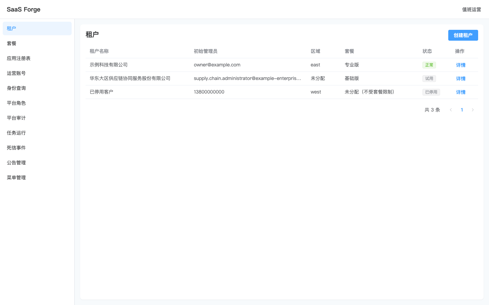
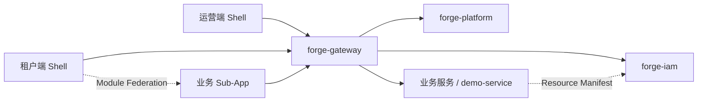

# SaaS Forge

**多租户 SaaS 平台与业务开发 SDK**

简体中文 | [English](README-en.md)

SaaS Forge 提供运营端、租户端、身份与权限服务，以及按能力拆分的 Spring Boot Starter 和 Vue 子应用工具。业务团队可以在独立仓库开发后端服务与前端子应用，复用租户隔离、认证授权、菜单、审计和消息等基础能力。

[本地运行](#本地运行) · [业务接入](#开发业务服务与子应用) · [SDK](#forge-sdk) · [验证与 CI](#验证与-ci) · [文档](#文档)

## 已实现能力

| 领域           | 能力                                                                                                                           |
| -------------- | ------------------------------------------------------------------------------------------------------------------------------ |
| 身份与账号安全 | 全局身份与租户成员关系、多租户切换；运营与租户双 Realm；OAuth2 授权码 + PKCE、刷新轮换、即时失效、TOTP MFA、登录锁定与密码管理 |
| 租户运营       | 租户开通、初始化、停用与删除流程；套餐与 Feature Pack；运营账号、平台角色与应用注册表                                          |
| 组织与权限     | 成员邀请、部门、岗位、扩展属性；RBAC 功能权限、ABAC 数据权限；租户 IP 允许列表、按权限与套餐裁剪菜单                           |
| 租户隔离       | PostgreSQL 共享 schema 模式；MyBatis-Plus 租户条件与 PostgreSQL RLS；缓存、消息和任务中的租户上下文                            |
| 日常协作       | 站内通知、业务待办、公告、审计日志、字典与参数、菜单布局管理                                                                   |
| 业务与运维     | S3 对象存储、异步 Excel 导入导出、业务编号、租户定时任务与运行记录；Outbox、幂等消费、死信查询与重放                           |
| 业务扩展       | 后端 Maven archetype、前端 Sub-App 生成器、Module Federation 动态加载、共享 SDK/UI 与接入规范                                  |

仓库内的 `demo-service` 与 `demo-sub-app` 演示订单、附件、导入导出、通知与待办等能力的组合使用。

<details>
<summary>界面预览：运营端租户管理</summary>



截图来自仓库的视觉回归基线，使用测试数据；当前界面文案以简体中文为主。

</details>

## 架构与目录



网关负责路由与认证入口，IAM 管理身份、权限和租户访问上下文，Platform 管理租户运营与服务运维。业务服务通过 Forge SDK 接入，并向 IAM 上报权限、菜单和数据资源声明；租户 Shell 根据权限、套餐和 App Registry 加载子应用。

```text
backend/                       Maven 多模块
  forge-dependencies/          BOM 与共享构建配置
  forge-architecture/          可复用的 ArchUnit 架构规则
  forge-sdk/                   17 个按能力拆分的 SDK 模块
  forge-gateway/               API 网关与聚合 OpenAPI
  forge-iam/                   身份、权限与租户侧基础能力
  forge-platform/              平台运营与运维服务
  forge-service-archetype/     仓库外 Business Service 脚手架
  examples/demo-service/       示例业务服务
frontend/                      pnpm workspace
  apps/platform-console/      运营端 Shell
  apps/tenant-app/             租户端 Shell
  apps/demo-sub-app/           示例子应用
  packages/sdk/               @crane199709/sdk
  packages/ui/                @crane199709/ui
  packages/sub-app-kit/       @crane199709/sub-app-kit
deploy/                        本地依赖、镜像说明与隔离验收环境
scripts/                       CI 范围选择、版本发布与镜像构建
docs/                          接入指南、规范与 ADR
```

| 层次     | 技术栈                                                                                                   |
| -------- | -------------------------------------------------------------------------------------------------------- |
| 后端     | Java 17、Spring Boot 4.0.9、Spring Cloud 2025.1.4、Spring Cloud Alibaba 2025.1.0.0、MyBatis-Plus、Flyway |
| 前端     | Vue 3、TypeScript 5.9、Vite、Element Plus、Pinia、Module Federation                                      |
| 基础设施 | PostgreSQL 17、Redis 8、Nacos 3、RocketMQ 5、S3 兼容对象存储                                             |
| 验证     | JUnit、Testcontainers、ArchUnit、Vitest、Playwright、Spotless、Prettier、Stylelint                       |

当前源码统一开发版本为 `0.2.0-SNAPSHOT`，后端以 `backend/.mvn/maven.config` 中的 `revision` 为准。仓库外接入须使用与目标平台配套的发布版本，版本管理见[发布指南](scripts/release/README.md)。

## 本地运行

以下命令默认从仓库根目录执行，用于独立的本地演示环境。

### 环境要求

- JDK 17；使用仓库自带的 `backend/mvnw`。
- Node.js 24+、pnpm 12.4.2。
- Docker 与 Compose v2。
- Bash、OpenSSL；E2E 与发布脚本还需要 Python 3。

### 1. 启动依赖

```bash
docker compose -f deploy/docker-compose.yml up -d
docker compose -f deploy/docker-compose.yml ps -a
```

Compose 启动数据库、缓存、注册配置中心、消息队列和对象存储。一次性任务 `nacos-init`、`rocketmq-init`、`s3-init` 分别发布配置、创建 Topic 和创建 bucket，应以退出码 0 完成。

| 依赖           | 默认宿主机端口           | 本地说明                                                                   |
| -------------- | ------------------------ | -------------------------------------------------------------------------- |
| PostgreSQL     | 5432                     | 数据库 `forge`；为 iam、platform、demo 分别准备 schema、迁移账号与运行账号 |
| Redis          | 6379                     | 会话、权限版本、租户状态等                                                 |
| Nacos          | 8848、9848；控制台 18080 | [控制台](http://localhost:18080)，本地账号 `nacos/nacos`                   |
| RocketMQ Proxy | 8081                     | Java 原生客户端使用的 gRPC 入口                                            |
| S3 兼容存储    | 9000                     | 本地使用 silo，bucket 为 `forge`                                           |

数据保存在被 Git 忽略的 `deploy/data/`。PostgreSQL 初始化只对空数据目录执行；已有库接入新服务时按[平台侧接入清单](docs/service-onboarding-checklist.md)准备 schema 和账号。端口覆盖变量见 [Compose 配置](deploy/docker-compose.yml)，调整端口后须同步应用连接配置。

### 2. 构建并准备各服务的私有配置

```bash
(cd backend && ./mvnw clean install -DskipTests)
pnpm --dir frontend install --frozen-lockfile
umask 077
cp -n .env.iam.example .env.iam.local
cp -n .env.platform.example .env.platform.local
cp -n .env.demo.example .env.demo.local
mkdir -p deploy/data
cp -n deploy/config/forge-platform.example.yaml deploy/data/forge-platform.yaml
```

每个服务的 `FORGE_OPS_TOKEN` 填独立随机值（可用 `openssl rand -hex 32` 生成）。Platform、Demo 的 `FORGE_MANIFEST_TOKEN` 填在 IAM 登记的服务凭证，不能用运维令牌替代。IAM 自身直接登记清单，只需要自己的运维令牌。已有环境迁移时保留现有值，不重新生成。

Platform 的完整运维映射统一维护在私有 `deploy/data/forge-platform.yaml`：键为真实 `spring.application.name`，值与目标服务的 `FORGE_OPS_TOKEN` 一致。内置服务和外部 Lowcode 都在这一份映射中配置；Platform 自身条目可引用 `${FORGE_OPS_TOKEN}`。`.env.*.local` 和 `deploy/data/` 被 Git 忽略。

首次启动顺序为 IAM → 登记 Platform/Demo 凭证 → 填写各自环境文件 → 启动 Platform/Demo。平台自身尚不能上报时，由持有 IAM Ops Token 的管理员通过 `POST /internal/ops/service-credentials` 登记，步骤见[服务指南](docs/business-service-guide.md#服务凭证获取与轮换)。

### 3. 启动后端

各终端在仓库根目录读取构建版本，再只加载对应服务的环境文件：

```bash
FORGE_VERSION=$(sed -n 's/^-Drevision=//p' backend/.mvn/maven.config)
```

```bash
(set -a; source .env.iam.local; set +a
 java -jar "backend/forge-iam/target/forge-iam-${FORGE_VERSION}.jar" --spring.profiles.active=demo)
```

```bash
(set -a; source .env.platform.local; set +a
 java -jar "backend/forge-platform/target/forge-platform-${FORGE_VERSION}.jar")
```

```bash
(set -a; source .env.demo.local; set +a
 java -jar "backend/examples/demo-service/target/demo-service-${FORGE_VERSION}.jar")
```

```bash
java -jar "backend/forge-gateway/target/forge-gateway-${FORGE_VERSION}.jar"
```

> [!IMPORTANT]
> `demo` profile 会写入已知密码的演示账号，只用于独立本地环境。默认启动不加载演示账号；同一个数据库执行过演示迁移后，后续启动须继续启用该 profile，否则 Flyway 校验会失败。

| 服务           | 默认端口 | 网关前缀    |
| -------------- | -------- | ----------- |
| forge-gateway  | 8080     | —           |
| forge-iam      | 8101     | `/iam`      |
| forge-platform | 8102     | `/platform` |
| demo-service   | 8201     | `/demo`     |

服务启动时以迁移账号执行 Flyway，以运行账号访问数据。共享配置读取 Nacos 的 `forge-common.yaml`，网关另读 `forge-gateway.yaml`；Platform 另读受控的 `forge-platform.yaml`，与本地完整映射结构一致。连接池和租户会话数据源不参与热刷新，数据库连接配置变更后需重启服务。

IDEA 中将 IamApplication、PlatformApplication、DemoApplication 的环境文件分别设为 `.env.iam.local`、`.env.platform.local`、`.env.demo.local`，工作目录均为仓库根目录；IAM 启用 `demo` profile。不要让多个服务加载同一份含通用变量名的文件。外部 Lowcode 已使用自身 `.env.local`，继续保持独立。

### 4. 启动前端并登录

在三个终端分别运行：

```bash
pnpm --dir frontend dev:platform
```

```bash
pnpm --dir frontend dev:tenant
```

```bash
pnpm --dir frontend start:demo
```

| 入口          | 地址                                                   | 演示账号                        | 演示密码                 |
| ------------- | ------------------------------------------------------ | ------------------------------- | ------------------------ |
| 运营端        | [localhost:5173](http://localhost:5173)                | `operator`                      | `Operator-password-123!` |
| 租户端        | [localhost:5174](http://localhost:5174)                | `demo`                          | `Demo-password-123!`     |
| 示例 Sub-App  | [remoteEntry.js](http://127.0.0.1:5175/remoteEntry.js) | 由租户 Shell 加载，共用租户会话 | —                        |
| 聚合 API 文档 | [Swagger UI](http://localhost:8080/swagger-ui.html)    | 按服务切换                      | —                        |

`start:demo` 先构建再预览，源码修改后需重新执行。IAM 的演示数据已登记 `local` 环境的示例入口；可登录租户端查看订单页面。账号与认证详情见[租户登录](docs/tenant-login.md)和[运营登录](docs/platform-login.md)。

常见排查入口：

- 出现 `forge.ops.token must be set`：检查当前终端或 IDE 的环境变量；更换令牌后同步更新 Platform 与对应服务并重启。
- 网关没有路由：确认 `nacos-init` 成功；修改仓库中的 Nacos 配置后执行 `docker compose -f deploy/docker-compose.yml up nacos-init` 重新发布。
- 子应用未显示或加载失败：检查 `start:demo`、入口地址、IAM 的 `FORGE_ENVIRONMENT`（默认 `local`）以及成员权限与套餐范围。

## 开发业务服务与子应用

后端与前端可在仓库外独立开发：

1. 使用 `io.saasforge:forge-service-archetype` 生成 Business Service，继承 `forge-dependencies`，按需组合 SDK。完整命令与必配项见[业务服务接入指南](docs/business-service-guide.md)。
2. 使用 `@crane199709/sub-app-kit` 的 `forge-create-sub-app` 生成 Sub-App，复用 `@crane199709/sdk` 和 `@crane199709/ui`。仓库外生成、独立开发宿主与发布步骤见[子应用指南](docs/sub-app.md)。
3. 由平台侧准备数据库账号、Manifest 令牌、Topic、网关路由与认证前缀，并登记 App Registry、配置套餐和角色权限。按[接入清单](docs/service-onboarding-checklist.md)逐项验证。

仓库内创建子应用的示例：

```bash
cd frontend
pnpm create:sub-app billing 5180
pnpm install
pnpm --filter @forge/billing-sub-app dev
```

独立开发宿主支持 HMR；实际的联邦加载通过构建产物与租户 Shell 验证。新业务前缀还需加入 Shell 的开发代理；只设置 Sub-App 的 `apiPrefixes` 不会更新 Shell 代理。Shell、Sub-App 与共享包使用同一配套版本，共享依赖不单独升级。

## Forge SDK

后端制品使用 `io.saasforge` 坐标，由 `forge-dependencies` 统一管理版本。

| 模块（省略 `forge-sdk-` 前缀） | 职责                                                   |
| ------------------------------ | ------------------------------------------------------ |
| `core`、`web`、`openapi`       | 租户上下文、统一响应与错误、分页、业务时区、OpenAPI    |
| `security`、`tenant`、`abac`   | JWT 验签、功能权限、租户 SQL 隔离与 RLS 会话、数据策略 |
| `manifest`、`provisioning`     | 权限与菜单声明上报、租户初始化与清理扩展点             |
| `mq`、`notification`           | RocketMQ、事务 Outbox、幂等消费、死信、通知与待办事件  |
| `audit`、`ops`、`scheduling`   | 审计事件、独立令牌运维通道、声明式定时任务与运行历史   |
| `storage`、`io`                | 按用途约束的 S3 存储、异步 Excel 导入校验与确认、导出  |
| `numbering`、`referencedata`   | 业务编号、当前租户生效的字典与参数                     |

前端三个发布包分别提供会话与 API 客户端、共享 UI 组件，以及生成器、构建配置和隔离检查。接入约束见[后端规范](docs/standards/business-service.md)与[前端规范](docs/standards/sub-app.md)。

## 验证与 CI

| 质量工作流       | 覆盖内容                                                                          |
| ---------------- | --------------------------------------------------------------------------------- |
| Backend quality  | Maven 测试、Testcontainers 集成测试、ArchUnit、Spotless 与 archetype 生成工程验证 |
| Frontend quality | 类型检查、单测、Prettier、Stylelint、构建与 mock 浏览器回归                       |
| Main flow E2E    | 真实登录与子应用加载、双租户隔离、功能与数据权限、即时失效、Realm 隔离            |
| Template smoke   | 临时 Maven/npm 发布、仓库外生成工程、构建与运行接入验证                           |

PR 与 `main` 推送按变更范围选择重检查；手动触发与发布标签执行全量。普通 Markdown 改动跳过重检查，规则见 [CI 说明](docs/ci.md)。

常用本地命令：

```bash
# 后端完整验证，包含生成工程的独立消费测试
(cd backend && ./mvnw --batch-mode install -Parchetype-it)

# 前端类型、单测、格式、样式与构建
(cd frontend && pnpm typecheck && pnpm test && pnpm format:check && pnpm lint:style && pnpm build)

# mock 浏览器回归；build:spike 准备诊断页面与子应用 v2
(cd frontend && pnpm build:spike && pnpm exec playwright install --with-deps chromium && pnpm test:e2e)

# 独立容器环境中的真实主链路与模板冒烟（分别运行）
deploy/e2e/run.sh
deploy/template-smoke/run.sh

# 通知与待办专项真实 E2E，当前为手动运行
pnpm --dir frontend test:e2e:notification
```

迭代后端模块时，先在 `backend` 执行 `./mvnw -o -pl <模块> -am install -DskipTests`，再用 `./mvnw -o -pl <模块> test -Dtest=<测试类>` 定向验证；离线命令要求依赖已缓存。格式修复使用 `(cd backend && ./mvnw spotless:apply)` 与 `pnpm --dir frontend format`，视觉回归使用 `pnpm --dir frontend test:visual`。

主链路 E2E 使用独立 PostgreSQL/Redis 容器，退出后清理本次容器与卷，日志保留在 `deploy/e2e/run-*`。该套用例关闭 MQ 与 Nacos；验证边界、端口和报告位置见[主链路 E2E](docs/main-flow-e2e.md)。Linux 首次运行真实 E2E 前需安装 Playwright Chromium 系统依赖。

## 文档

| 需要了解       | 入口                                                                                                                                                 |
| -------------- | ---------------------------------------------------------------------------------------------------------------------------------------------------- |
| 术语与架构决策 | [领域术语](GLOSSARY.md) · [ADR](docs/adr/)                                                                                                           |
| 后端服务接入   | [业务服务指南](docs/business-service-guide.md) · [平台侧接入清单](docs/service-onboarding-checklist.md)                                              |
| 前端子应用接入 | [Sub-App 与 App Registry](docs/sub-app.md) · [前端规范](docs/standards/sub-app.md)                                                                   |
| 身份与账号安全 | [租户登录](docs/tenant-login.md) · [运营登录](docs/platform-login.md)                                                                                |
| 权限与审计     | [平台权限](docs/platform-permission.md) · [数据权限](docs/data-permission.md) · [审计](docs/audit.md)                                                |
| 开发与验收     | [后端规范](docs/standards/business-service.md) · [前端设计](docs/agents/frontend-design.md) · [主链路 E2E](docs/main-flow-e2e.md) · [CI](docs/ci.md) |
| 版本与部署     | [SDK 发布指南](scripts/release/README.md) · [镜像构建与运行配置](deploy/images/README.md)                                                            |
